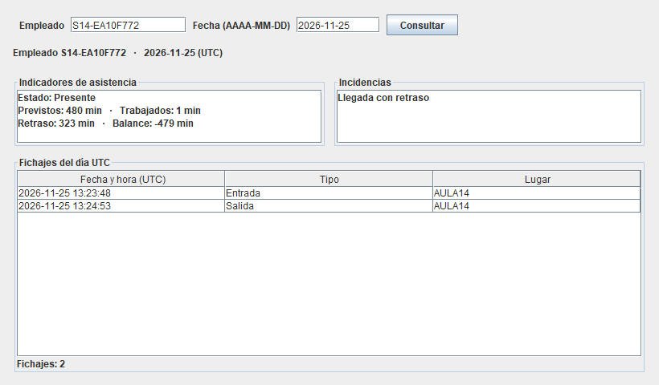

# Control de Presencia

Proyecto individual de **Ingeniería del Software II** de la Universidad de Las Palmas de Gran Canaria (ULPGC).

## Descripción

Sistema de control de presencia orientado al registro de entradas y salidas de empleados, la definición y asignación de horarios laborales y el cálculo de indicadores de asistencia.

El proyecto se desarrolla de forma incremental, tomando como punto de partida el modelo de registro trabajado en clase y ampliándolo mediante principios de diseño orientado a objetos, programación funcional cuando resulta apropiada, pruebas automatizadas y arquitectura hexagonal.

El objetivo es construir un sistema modular, mantenible y verificable, capaz de representar diferentes situaciones laborales y evolucionar hacia varias aplicaciones independientes.

## Estado actual del proyecto

**Última verificación en `develop` · 25 de noviembre de 2026.** Los tres escritorios Swing completaron el recorrido de administración, registro y consulta contra el backend de Docker Compose por TCP local. La compilación del 23 de noviembre con JDK 27 había superado las 204 pruebas de los seis módulos.

### Sesión 14 · Un empleado, un horario y dos fichajes

Administración asignó al empleado de prueba una jornada de 08:00 a 16:00. Registro obtuvo del servidor los justificantes de entrada a las 13:23:48 UTC y de salida a las 13:24:53 UTC. Consulta diaria mostró ambos fichajes en el centro `AULA14` y el estado **Presente**. Los 65 segundos transcurridos computaron como un minuto trabajado. Para una jornada prevista de 480 minutos, el balance fue de **−479 minutos**. Al repetir la asignación para el mismo período, el servidor rechazó el solapamiento.



[Informe del recorrido automatizado y cinco capturas de los tres escritorios](docs/sesion14/20261125-132344-bec03b/RESULTADO.md)

### Funcionalidad implementada

- Modelo de dominio para empleados, lugares y fichajes.
- Registro y consulta de eventos de entrada y salida.
- Validación de secuencias de fichajes.
- Persistencia de eventos en archivos.
- Horarios continuos, partidos y por turnos.
- Soporte de turnos que cruzan la medianoche.
- Modelo de guardias presenciales y localizadas.
- Asignaciones de horarios con periodos de validez.
- Cálculo de indicadores diarios de asistencia.
- Arquitectura hexagonal mediante puertos y adaptadores.
- Proyecto Maven multimódulo.
- Backend HTTP/JSON desarrollado con Javalin.
- API de administración de empleados, horarios y asignaciones.
- Persistencia administrativa mediante archivos JSONL.
- Ejecución del backend con Docker Compose.
- Conservación de datos después de recrear el contenedor.
- Tres aplicaciones Swing independientes para administrar empleados y horarios, registrar fichajes y consultar la asistencia por empleado y fecha.
- Pruebas automatizadas con JUnit 5 y AssertJ.

**Sesión 12 · Consulta diaria e incidencias.**

La consulta recupera el horario asignado y muestra los indicadores calculados por el servidor junto con los fichajes del día UTC. La guía de ejecución y el ejemplo HTTP están en la sección de consulta.

La revisión asíncrona del 18 de noviembre de 2026 superó **143 pruebas** sin fallos, errores ni pruebas omitidas. El resultado de la primera versión de la sesión 11 se conserva en la sección de compilación y pruebas.

**Sesión 13 — Administración.** El módulo `frontend-admin` permite crear empleados y horarios y asignar un horario durante un período. Los tres escritorios utilizan la misma API y los mismos datos del backend.

---

## Arquitectura del sistema

El proyecto sigue una **arquitectura hexagonal**, separando el modelo de dominio, los casos de uso y las tecnologías de infraestructura.

El diseño aplica especialmente los siguientes principios:

- **Responsabilidad única (SRP):** cada componente tiene una función definida.
- **Inversión de dependencias (DIP):** los casos de uso dependen de contratos, no de adaptadores concretos.
- **DRY:** se evita duplicar responsabilidades y lógica compartida.
- **Sustitución de Liskov:** las implementaciones de los contratos pueden sustituirse respetando su comportamiento.
- **Bajo acoplamiento:** las tecnologías externas se mantienen fuera del núcleo del dominio.
- **Composición:** las dependencias se construyen y conectan desde un punto de configuración.

### Organización Maven multimódulo

El proyecto contiene seis módulos.

| Módulo | Responsabilidad |
|---|---|
| `domain` | Modelos, contratos del dominio y reglas de negocio |
| `application` | Casos de uso y puertos de entrada y salida |
| `backend` | Adaptadores HTTP, persistencia y configuración de ejecución |
| `frontend-register` | Aplicación Swing de registro de fichajes |
| `frontend-query` | Aplicación Swing de consulta diaria y adaptador HTTP de lectura |
| `frontend-admin` | Aplicación Swing de altas de empleados, horarios y asignaciones |

Los módulos organizan el código en `src/main/java` y las pruebas en `src/test/java`. En `frontend-query`, el paquete `software.ulpgc.register.query` contiene `QueryMain`, `model`, `application`, `port`, `adapter/http` y `adapter/swing`.

Estructura del núcleo y del escritorio de registro:

```text
control-presencia/
├── pom.xml
├── Dockerfile
├── compose.yaml
├── .dockerignore
├── .gitignore
├── README.md
│
├── domain/
│   ├── pom.xml
│   └── src/
│       ├── main/java/software/ulpgc/register/domain/model/
│       │   ├── attendance/
│       │   └── schedule/
│       └── test/java/
│
├── application/
│   ├── pom.xml
│   └── src/
│       ├── main/java/software/ulpgc/register/application/
│       │   ├── port/
│       │   │   ├── in/
│       │   │   └── out/
│       │   └── usecase/
│       └── test/java/
│
├── backend/
│   ├── pom.xml
│   └── src/
│       ├── main/java/software/ulpgc/register/infrastructure/
│       │   ├── adapter/
│       │   │   ├── in/http/
│       │   │   └── out/persistence/
│       │   └── configuration/
│       └── test/java/
│
└── frontend-register/
    ├── pom.xml
    └── src/
        ├── main/java/software/ulpgc/register/frontend/
        │   ├── FrontendMain.java
        │   ├── adapter/
        │   │   ├── http/
        │   │   └── swing/
        │   ├── application/
        │   ├── model/
        │   └── port/
        └── test/java/
```

### Dirección de dependencias

```text
                 domain
                   ▲
                   │
              application
                   ▲
                   │
                backend  ◄── HTTP/JSON ── frontend-register, frontend-query, frontend-admin
```

El módulo `backend` también puede depender directamente de `domain` cuando necesita construir o adaptar sus modelos.

Las dependencias cumplen estas reglas:

- `domain` no depende de `application` ni de `backend`.
- `application` depende del dominio, pero no de la infraestructura.
- `backend` depende de los contratos y modelos necesarios para implementar sus adaptadores.
- Los tres escritorios utilizan tipos propios, `java.net.http.HttpClient` y Jackson. Cada aplicación se comunica directamente con el servidor y tiene su propio punto de entrada.
- Las pruebas de integración del frontend dependen de `backend` con alcance Maven `test`, para probar el cliente contra Javalin y repositorios temporales reales.

De esta forma, la lógica de negocio no necesita conocer Javalin, Docker, Jackson ni los detalles de los archivos.

### Arquitectura del frontend de registro

`FrontendMain` construye y conecta los componentes de la aplicación de escritorio:

| Componente | Responsabilidad |
|---|---|
| `PunchData`, `PunchType`, `PunchReceipt` | Datos del formulario y confirmación de la API |
| `PunchGateway` | Puerto de registro que devuelve `CompletableFuture<PunchReceipt>` |
| `PunchController` | Validación de entrada y coordinación de la operación asíncrona |
| `HttpPunchGateway` | Conversión JSON, llamada con `HttpClient.sendAsync` y tratamiento de errores |
| `PunchPanel` | Formulario Swing y presentación del resultado |

El controlador depende del puerto remoto y de una vista, sin conocer Swing ni Javalin. El adaptador HTTP utiliza `HttpClient.sendAsync` y entrega el resultado como `CompletableFuture` a través del puerto. El controlador encadena la confirmación o el error sin esperar de forma bloqueante; el flujo de producción no utiliza `join()` ni `get()` para obtener el resultado de la petición.

Esta revisión aplica el enfoque asíncrono trabajado en la semana 10: el futuro se mantiene desde la comunicación HTTP hasta el controlador. Las actualizaciones de Swing se programan en su hilo de eventos (EDT), sin ocuparlo mientras se espera al servidor. Durante una petición pendiente se bloquea un segundo envío y, al terminar, se recuperan los controles conservando los datos del formulario. No hay reenvíos automáticos ante un resultado incierto. El servidor conserva la responsabilidad de validar la secuencia de entradas y salidas.

### Puertos de entrada

Los puertos de entrada expresan las operaciones disponibles para los consumidores de la aplicación.

Entre los contratos implementados se encuentran:

| Puerto | Responsabilidad |
|---|---|
| `RegisterPunchCommand` | Registrar fichajes |
| `TrackingEventsQuery` | Consultar fichajes almacenados |
| `DailyAttendanceQuery` | Calcular un resumen diario con el horario y la asignación recibidos |
| `AttendanceReportQuery` | Consultar asistencia por empleado y fecha resolviendo su asignación vigente |
| `RegisterEmployeeCommand` | Registrar empleados |
| `RegisterScheduleCommand` | Registrar horarios |
| `AssignScheduleCommand` | Asignar horarios |
| `AdministrationQuery` | Consultar datos administrativos |

Los adaptadores HTTP utilizan estos contratos para acceder a los casos de uso sin depender directamente de sus implementaciones concretas.

### Puertos de salida

Los puertos de salida definen las operaciones de persistencia que necesita la aplicación.

| Puerto | Responsabilidad |
|---|---|
| `EventStore` | Registrar y recuperar eventos de presencia |
| `EmployeeRepository` | Almacenar y consultar empleados |
| `ScheduleRepository` | Almacenar y consultar horarios |
| `ScheduleAssignmentRepository` | Almacenar y consultar asignaciones |

Estas interfaces pertenecen al módulo `application`.

### Casos de uso

Los principales casos de uso implementados son:

- `RegisterTrackingEvent`: valida y registra entradas y salidas.
- `ListTrackingEvents`: consulta eventos registrados.
- `CalculateDailyAttendance` calcula los indicadores diarios. `GetDailyAttendance` valida el empleado y utiliza `ResolveDailySchedule` para recuperar la asignación vigente antes de invocar el cálculo.
- `RegisterEmployee`: registra empleados y rechaza identificadores duplicados.
- `RegisterSchedule`: registra definiciones de horarios.
- `AssignScheduleToEmployee`: comprueba referencias y periodos antes de guardar una asignación.
- `ReadAdministrationData`: recupera empleados, horarios y asignaciones.

Cada caso de uso coordina las operaciones necesarias sin implementar directamente el acceso a archivos ni la comunicación HTTP.

### Adaptadores de infraestructura

El backend incorpora adaptadores de entrada y salida.

**Adaptadores HTTP:**

- `ApiServer`: configura las rutas HTTP y los manejadores de errores.
- `AdministrationHandlers`: transforma las peticiones de administración y sus respuestas.

**Adaptadores de persistencia:**

- `FileEventStore`
- `FileEmployeeRepository`
- `FileScheduleRepository`
- `FileScheduleAssignmentRepository`
- `JsonlFile`
- `ScheduleJsonCodec`

`ScheduleJsonCodec` centraliza la conversión de los distintos tipos de horario para su almacenamiento JSONL.

### Configuración y arranque

`ServerMain` actúa como raíz de composición del backend.

Su responsabilidad es construir los repositorios, conectar los casos de uso con sus puertos y configurar el servidor HTTP.

---

## Registro de presencia

El sistema representa empleados y lugares mediante `Employee` y `Place`.

Los fichajes se modelan mediante:

- `TrackingEvent`: evento de registro con marca temporal.
- `TrackingType`: tipo de evento, entrada o salida.
- `StoredTrackingEvent`: representación de eventos recuperados del almacenamiento.

### Registro de entradas y salidas

El caso de uso `RegisterTrackingEvent` verifica que los eventos respeten una secuencia coherente.

Entre las reglas implementadas se encuentran:

- Una entrada no puede seguir a otra entrada que todavía esté abierta.
- Una salida necesita una entrada anterior.
- No se permiten dos salidas consecutivas sin una nueva entrada.
- Los nuevos eventos deben respetar el orden cronológico.
- La validación de la secuencia se realiza por empleado.

Estas comprobaciones impiden registrar determinadas secuencias incoherentes.

### Fichajes nocturnos

El caso de uso consulta eventos de la fecha UTC del nuevo fichaje y de la fecha UTC anterior.

Esto permite reconocer una entrada antes de medianoche y su correspondiente salida durante el día siguiente.

Ejemplo:

```text
04/11/2026 22:00 UTC → Entrada
05/11/2026 06:00 UTC → Salida
```

La implementación cubre este escenario básico de trabajo nocturno.

Todavía no constituye un mecanismo general de reconstrucción de jornadas abiertas durante varios días ni ofrece garantías de registro atómico entre procesos concurrentes.

### Persistencia de fichajes

`FileEventStore` implementa el puerto `EventStore`.

Almacena los eventos en archivos de texto organizados por año y fecha UTC.

Cada registro contiene:

- Marca temporal.
- Identificador del empleado.
- Identificador del lugar.
- Tipo de fichaje.

Los campos se almacenan en líneas delimitadas por tabuladores.

**Importante:** el almacenamiento de fichajes es diferente del almacenamiento administrativo JSONL.

Los fichajes existentes no se han migrado a JSONL.

---

## Modelo de horarios

El dominio dispone de un contrato común `Schedule` que permite trabajar con diferentes modalidades mediante polimorfismo.

Entre sus operaciones se encuentran la consulta de tramos de trabajo para una fecha y el cálculo de minutos previstos.

### Tramos horarios

`TimeSlot` representa un intervalo mediante una hora de inicio y una hora de finalización.

Permite calcular la duración de un tramo y reconocer intervalos que cruzan medianoche.

### Horarios continuos

`ContinuousSchedule` representa jornadas con un único tramo durante determinados días laborables.

Ejemplo:

```text
Lunes a viernes
08:00–16:00
Duración prevista: 8 horas
```

### Horarios partidos

`SplitSchedule` representa jornadas con dos o más tramos diferenciados.

Ejemplo:

```text
10:00–14:00 → 4 horas
18:00–22:00 → 4 horas

Total previsto: 8 horas
```

El modelo permite ordenar los tramos cronológicamente, comprobar sus restricciones y rechazar solapamientos.

### Horarios por turnos

`ShiftSchedule` permite asociar distintos tramos a los días de la semana.

Ejemplos:

```text
Turno de mañana: 06:00–14:00
Turno de tarde:  14:00–22:00
Turno nocturno:  22:00–06:00
```

Los turnos nocturnos se atribuyen a la fecha en la que comienzan.

El modelo actual permite una distribución semanal de turnos, pero no incorpora rotaciones automáticas de varias semanas.

### Asignaciones de horarios

`ScheduleAssignment` relaciona un empleado con un horario durante un periodo de fechas.

Los extremos del intervalo se consideran incluidos.

Las asignaciones cuentan con:

- Persistencia JSONL.
- Comprobación de existencia del empleado.
- Comprobación de existencia del horario.
- Validación de periodos.
- Rechazo de asignaciones solapadas para un mismo empleado.

Las validaciones actuales no constituyen una garantía de atomicidad frente a operaciones concurrentes.

### Guardias

`Duty` representa una guardia asociada a un empleado, un periodo y una modalidad.

Se contemplan dos modalidades:

- `ON_SITE`: guardia presencial.
- `ON_CALL`: guardia localizada.

En el modelo de dominio, una guardia presencial aporta los minutos previstos correspondientes.

Una guardia localizada representa un periodo de disponibilidad, que no se considera automáticamente tiempo de presencia efectiva.

La administración persistente de guardias, las activaciones de guardias localizadas y su integración completa con la asistencia todavía están pendientes.

---

## Cálculo diario de asistencia

`CalculateDailyAttendance` calcula un resumen diario para un empleado, una fecha y una asignación de horario.

Utiliza el puerto `EventStore` para recuperar los fichajes y el contrato `Schedule` para consultar los periodos de trabajo previstos.

El resultado se representa mediante `AttendanceSummary`.

### Indicadores calculados

- Minutos previstos.
- Minutos trabajados.
- Minutos de retraso.
- Diferencia entre minutos trabajados y previstos.
- Estado de asistencia.

Los estados disponibles son:

| Estado | Significado general |
|---|---|
| `PRESENT` | Jornada con presencia registrada |
| `ABSENT` | Ausencia respecto al trabajo previsto |
| `OFF` | Día sin trabajo previsto |
| `UNSCHEDULED` | Sin una programación aplicable |
| `INCOMPLETE` | Jornada con registros incompletos |

### Ejemplo de cálculo

Horario previsto:

```text
08:00–16:00
480 minutos
```

Fichajes:

```text
Entrada: 08:10
Salida:  16:05
```

Resultado:

```text
Minutos previstos: 480
Minutos trabajados: 475
Retraso: 10 minutos
Diferencia: -5 minutos
Estado: PRESENT
```

### Alcance del cálculo

Los periodos de trabajo se atribuyen a la fecha UTC de entrada.

Para completar una jornada nocturna se consultan los fichajes necesarios de la fecha de inicio y de la siguiente.

El cálculo comprueba la coherencia de la asignación con el empleado, el horario y el periodo solicitado.

Los resultados de jornadas incompletas no deben considerarse definitivos.

`GetDailyAttendance` consulta los repositorios administrativos. El adaptador HTTP expone el resultado y las incidencias automáticas. Quedan pendientes los festivos, los permisos y las zonas horarias de cada centro.

---

## Backend HTTP

El backend utiliza **Javalin 7** sobre Java 27.

El puerto predeterminado es `7070`.

La dirección base para ejecución local es:

`http://localhost:7070`

Las operaciones se comunican mediante HTTP y JSON.

### Endpoints de registro de presencia

| Método | Ruta | Descripción |
|---|---|---|
| GET | `/api/v1/health` | Comprueba el estado del servidor |
| POST | `/api/v1/punches` | Registra una entrada o salida |
| GET | `/api/v1/punches` | Consulta fichajes por empleado y fecha UTC |
| GET | `/api/v1/attendance` | Devuelve los indicadores y las incidencias del empleado para esa fecha |

### Registrar una entrada

Petición `POST /api/v1/punches`:

```json
{
  "employeeId": "EMP-DEMO-001",
  "employeeName": "Empleado de prueba",
  "placeId": "OFFICE-DEMO",
  "placeName": "Oficina de prueba",
  "type": "IN"
}
```

Para registrar una salida se utiliza `OUT` en el campo `type`.

La marca temporal del evento se genera en el servidor.

Una petición válida devuelve HTTP `201 Created`.

### Consultar fichajes

Ejemplo:

```text
GET /api/v1/punches?date=2026-11-11&employeeId=EMP-DEMO-001
```

La respuesta contiene los eventos correspondientes al empleado y a la fecha UTC solicitada.

### Endpoints administrativos

| Método | Ruta | Descripción |
|---|---|---|
| POST | `/api/v1/employees` | Registrar empleado |
| GET | `/api/v1/employees/{id}` | Consultar empleado |
| POST | `/api/v1/schedules` | Registrar horario |
| GET | `/api/v1/schedules/{id}` | Consultar horario |
| POST | `/api/v1/assignments` | Crear asignación |
| GET | `/api/v1/employees/{id}/assignments` | Consultar asignaciones |

### Registrar un empleado

Petición `POST /api/v1/employees`:

```json
{
  "id": "EMP-S10-001",
  "name": "Empleado de prueba"
}
```

Una petición válida devuelve HTTP `201 Created`.

Intentar registrar nuevamente el mismo identificador produce HTTP `409 Conflict` con el mensaje `Employee already exists`.

### Registrar un horario continuo

Petición `POST /api/v1/schedules`:

```json
{
  "type": "CONTINUOUS",
  "id": "OFFICE-S10-001",
  "name": "Oficina",
  "slot": {
    "start": "08:00",
    "end": "16:00"
  },
  "workingDays": [
    "MONDAY",
    "TUESDAY",
    "WEDNESDAY",
    "THURSDAY",
    "FRIDAY"
  ]
}
```

### Registrar un horario partido

Petición `POST /api/v1/schedules`:

```json
{
  "type": "SPLIT",
  "id": "RESTAURANT-S10-001",
  "name": "Restaurante",
  "slots": [
    {
      "start": "10:00",
      "end": "14:00"
    },
    {
      "start": "18:00",
      "end": "22:00"
    }
  ],
  "workingDays": [
    "MONDAY",
    "TUESDAY",
    "WEDNESDAY"
  ]
}
```

### Registrar un turno nocturno

Petición `POST /api/v1/schedules`:

```json
{
  "type": "SHIFT",
  "id": "HOSPITAL-S10-001",
  "name": "Hospital",
  "weeklySlots": {
    "MONDAY": {
      "start": "22:00",
      "end": "06:00"
    }
  }
}
```

Los tres tipos de horario se han registrado y recuperado correctamente mediante peticiones HTTP durante las comprobaciones de integración manual.

### Asignar un horario a un empleado

Petición `POST /api/v1/assignments`:

```json
{
  "employeeId": "EMP-S10-001",
  "scheduleId": "OFFICE-S10-001",
  "validFrom": "2026-11-16",
  "validThrough": "2026-11-30"
}
```

La operación exige que el empleado y el horario existan.

Las asignaciones solapadas para un mismo empleado son rechazadas.

La consulta de asignaciones se realiza mediante:

```text
GET /api/v1/employees/EMP-S10-001/assignments
```

### Respuestas HTTP

| Código | Uso |
|---|---|
| `200 OK` | Consulta correcta |
| `201 Created` | Recurso o fichaje registrado |
| `400 Bad Request` | Datos o parámetros inválidos |
| `404 Not Found` | Recurso solicitado no encontrado |
| `409 Conflict` | Registro duplicado o conflicto de reglas |

Por ejemplo, una asignación solapada produce una respuesta como:

```json
{
  "error": "CONFLICT",
  "message": "Schedule assignments overlap"
}
```

En el estado actual de la API, algunas referencias administrativas inexistentes se clasifican como peticiones inválidas (`400`).

La clasificación de errores podrá refinarse cuando se complete el contrato HTTP.

**Limitación de integración:** el endpoint de fichajes todavía no valida automáticamente que el empleado esté registrado en el catálogo administrativo.

---

## Persistencia

El proyecto utiliza dos mecanismos de almacenamiento basados en archivos.

### Persistencia de eventos de presencia

`FileEventStore` registra los fichajes mediante líneas de texto delimitadas por tabuladores y organizadas por fecha UTC.

Permite recuperar eventos previamente almacenados, incluso mediante nuevas instancias del adaptador.

### Persistencia administrativa JSONL

Los adaptadores administrativos utilizan archivos **JSON Lines (JSONL)**, donde cada línea representa un objeto JSON independiente.

| Archivo | Información |
|---|---|
| `employees.jsonl` | Empleados registrados |
| `schedules.jsonl` | Definiciones de horarios |
| `assignments.jsonl` | Asignaciones entre empleados y horarios |

`JsonlFile` centraliza las operaciones de lectura y escritura.

`ScheduleJsonCodec` permite reconstruir los distintos tipos de horario al recuperar los registros.

El directorio de almacenamiento se configura mediante la variable de entorno `DATA_DIR`.

Por defecto, en ejecución local se utiliza:

```text
data/events
```

En Docker Compose se configura:

```text
/data/events
```

### Alcance y limitaciones

El almacenamiento permite conservar los datos utilizados en las pruebas de integración.

Sin embargo, los repositorios administrativos utilizan archivos de solo adición y no garantizan transacciones entre varios repositorios.

Tampoco proporcionan control completo de concurrencia entre procesos, actualización o eliminación segura de registros ni recuperación transaccional ante fallos durante una escritura.

La auditoría administrativa completa, incluyendo actor, operación y marca temporal, sigue pendiente.

---

## Aplicación de administración

Con JDK 27, desde la raíz del proyecto, ejecuta `mvn clean verify`. Arranca el backend con `docker compose up -d --build` y abre el escritorio desde otra terminal.

```powershell
java -jar frontend-admin/target/control-presencia-frontend-admin-0.1.0-SNAPSHOT.jar http://localhost:7070
```

1. En **Empleados**, crea un empleado ficticio con un código nuevo, por ejemplo `DEMO13-A`. Espera la confirmación.
2. En **Horarios**, crea `BASE13-A`. Para un horario continuo, selecciona el día de la prueba e introduce `08:00-16:00`. En uno partido, separa los tramos con comas. En uno por turnos, escribe el tramo de cada día laborable y deja los días libres en blanco.
3. En **Asignaciones**, introduce ambos códigos y un período que incluya la fecha de la prueba. Las dos fechas son inclusivas. Si un período se solapa, el backend explica el conflicto y conserva la asignación previa.
4. Abre **Registro** y ficha una entrada y una salida con el mismo código de empleado. En **Consulta diaria**, busca el código y la fecha UTC del fichaje. Con el horario continuo anterior deben aparecer 480 minutos previstos y los fichajes de esa fecha. Los minutos trabajados dependen del tiempo entre fichajes.

`AdminPanel` recoge los datos del formulario. `AdministrationGateway` define las tres operaciones que necesita el escritorio. `HttpAdministrationGateway` construye las peticiones JSON y utiliza `HttpClient.sendAsync`. La ventana muestra el resultado en el hilo de eventos de Swing y espera la confirmación antes de permitir otro envío. El backend sigue resolviendo los duplicados, los solapamientos y las reglas de los horarios.

## Aplicación de consulta diaria

Se necesita JDK 27, Maven y un escritorio gráfico. Desde la raíz del repositorio, compila el proyecto y arranca el backend. Compose conserva el volumen de datos al reconstruir la imagen.

```bash
mvn clean verify
docker compose up -d --build
java -jar frontend-query/target/control-presencia-frontend-query-0.1.0-SNAPSHOT.jar
```

El JAR de consulta incluye sus dependencias Jackson. Utiliza `--help` para ver las opciones. La URL indicada como argumento tiene prioridad sobre `API_BASE_URL`. El valor predeterminado es `http://localhost:7070`. El escritorio de registro tiene su propio JAR y su carpeta `lib/`.

Introduce el identificador de empleado y la fecha UTC (`AAAA-MM-DD`). Pulsa **Consultar**. Los indicadores y las incidencias proceden de `GET /api/v1/attendance`, donde el servidor resuelve la asignación vigente y ejecuta `CalculateDailyAttendance`. La tabla procede de `GET /api/v1/punches` y muestra hora UTC, entrada o salida y lugar. En una jornada nocturna, el resumen del día de entrada puede incluir una salida de la madrugada siguiente. Esa salida aparece en la tabla de su propia fecha UTC.

### Contrato observado en Javalin

Para una jornada de 08:00 a 16:00 con entrada a las 08:10 y salida a las 15:55, la respuesta a `GET /api/v1/attendance?employeeId=DEMO-S12&date=2026-11-20` fue HTTP 200.

```json
{"employeeId":"DEMO-S12","date":"2026-11-20","expectedMinutes":480,"workedMinutes":465,"lateMinutes":10,"balanceMinutes":-15,"status":"PRESENT","incidents":["LATE_ARRIVAL"]}
```

Con los mismos parámetros, `GET /api/v1/punches` devolvió ambos fichajes.

```json
[
  {"employeeId":"DEMO-S12","placeId":"SALA","type":"IN","timestamp":"2026-11-20T08:10:00Z"},
  {"employeeId":"DEMO-S12","placeId":"SALA","type":"OUT","timestamp":"2026-11-20T15:55:00Z"}
]
```

| Respuesta de asistencia | Qué muestra la aplicación |
|---|---|
| `incidents: []` | Sin incidencias |
| `LATE_ARRIVAL`, `ABSENCE`, `INCOMPLETE_PUNCHES`, `UNSCHEDULED_WORK` | Retraso, ausencia, secuencia incompleta o trabajo en día libre |
| Resumen de una versión anterior sin el campo `incidents` | Indicadores disponibles y aviso de que el servidor no detalla incidencias |
| HTTP 400 por empleado desconocido o falta de asignación | Motivo en español. Los fichajes siguen disponibles si su consulta termina correctamente |
| Fecha inexistente o formato incorrecto | Validación en el formulario. Si se llama directamente a la API, esta devuelve HTTP 400 con `INVALID_DATE` |
| Error de conexión, respuesta incompatible o servidor no disponible | Mensaje en la sección afectada. Los resultados anteriores se borran al iniciar una consulta |

### Responsabilidades y asincronía

`QueryMain` compone el adaptador `HttpAttendanceGateway`, el controlador `QueryController` y la vista `QueryPanel`. El controlador depende del puerto `AttendanceGateway`. Cada petición se envía con `HttpClient.sendAsync` y devuelve un `CompletableFuture`. Las dos respuestas se presentan de forma independiente en el hilo de eventos de Swing. El formulario se habilita cuando ambas terminan. La aplicación no modifica fichajes ni datos administrativos.

### Comprobación reproducible

`AttendanceHttpIntegrationTest` crea un directorio temporal, da de alta por HTTP un empleado ficticio, un horario y una asignación, y verifica el ejemplo anterior con los adaptadores reales de persistencia y HTTP. También cubre jornada incompleta, ausencia, trabajo nocturno y consultas sin asignación. `QueryLoopbackTest` comprueba el transporte de producción en un puerto TCP efímero. Las pruebas del controlador completan futuros en distinto orden y comprueban que el hilo de Swing permanece disponible.

```bash
mvn -pl frontend-query -am clean verify
java -jar frontend-query/target/control-presencia-frontend-query-0.1.0-SNAPSHOT.jar --help
```

Para repetir la comprobación desde el escritorio, usa un empleado de prueba existente con asignación vigente. Compara los resultados con las dos rutas HTTP para esa fecha. Cambia después a una fecha fuera de la asignación para comprobar el mensaje y la tabla de fichajes. Los datos de ejemplo de las pruebas se crean en directorios temporales.

## Ejecutar la aplicación de registro

Se necesitan JDK 27 y un entorno gráfico de escritorio. El frontend puede ejecutarse en el equipo y conectarse tanto al backend local como al backend de Docker.

### 1. Compilar y ejecutar las pruebas

Desde la raíz del repositorio:

```bash
mvn clean verify
```

Para construir el frontend y los módulos necesarios para sus pruebas de integración:

```bash
mvn -pl frontend-register -am clean verify
```

El empaquetado genera `frontend-register/target/control-presencia-frontend-register-0.1.0-SNAPSHOT.jar` y su carpeta `lib/`. Para mover la aplicación a otro directorio, hay que conservar el JAR y `lib/` juntos. Las bibliotecas del servidor y de pruebas no se incluyen en `lib/`.

### 2. Iniciar el backend

Con Docker disponible, seguir las instrucciones de la siguiente sección. Como alternativa, desde la raíz del proyecto:

```bash
mvn -pl backend -am install
mvn -f backend/pom.xml org.apache.maven.plugins:maven-dependency-plugin:3.6.1:copy-dependencies -DincludeScope=runtime
```

En PowerShell:

```powershell
java -cp "backend/target/control-presencia-backend-0.1.0-SNAPSHOT.jar;backend/target/dependency/*" software.ulpgc.register.infrastructure.configuration.ServerMain
```

En Linux o macOS, el separador del classpath es `:`:

```bash
java -cp "backend/target/control-presencia-backend-0.1.0-SNAPSHOT.jar:backend/target/dependency/*" software.ulpgc.register.infrastructure.configuration.ServerMain
```

El backend utiliza `PORT=7070` y `DATA_DIR=data/events` de forma predeterminada. Para una prueba manual aislada en PowerShell, puede fijarse `$env:DATA_DIR = "data/session11-demo"` antes de iniciarlo. Esa carpeta no accede al volumen Docker. No deben arrancarse dos backend en el mismo puerto ni varios procesos sobre los mismos archivos de datos.

### 3. Abrir el frontend

En otra terminal, desde la raíz del proyecto:

```bash
java -jar frontend-register/target/control-presencia-frontend-register-0.1.0-SNAPSHOT.jar
```

La dirección predeterminada es `http://localhost:7070`. Se puede configurar mediante `API_BASE_URL` o pasando una dirección como argumento; el argumento tiene prioridad:

```powershell
$env:API_BASE_URL = "http://localhost:7070"
java -jar frontend-register/target/control-presencia-frontend-register-0.1.0-SNAPSHOT.jar
java -jar frontend-register/target/control-presencia-frontend-register-0.1.0-SNAPSHOT.jar http://localhost:7070
java -jar frontend-register/target/control-presencia-frontend-register-0.1.0-SNAPSHOT.jar --help
```

La dirección es la base del servidor; no hay que añadir `/api/v1/punches`.

### Uso y alcance

1. Introducir identificador y nombre del empleado.
2. Introducir identificador y nombre del centro de trabajo.
3. Pulsar **Entrada** o **Salida**.
4. Esperar la confirmación con la marca temporal asignada por el servidor.

El formulario envía `employeeId`, `employeeName`, `placeId`, `placeName` y `type` (`IN` o `OUT`) a `POST /api/v1/punches`. Los nombres son obligatorios según el contrato actual, aunque el almacenamiento de fichajes conserva solamente los identificadores.

Los campos vacíos y los caracteres de control se rechazan antes del envío. La API también protege los identificadores frente a caracteres de control para evitar alterar el formato de los archivos. Los conflictos de secuencia y los errores de conexión se muestran en la interfaz; los datos del formulario se conservan. El cliente no reenvía automáticamente un fichaje: tras un error de red o una respuesta no válida puede desconocerse si el servidor llegó a guardarlo. Antes de volver a fichar, consultar los registros mediante `GET /api/v1/punches`.

Esta pantalla identifica al empleado mediante datos introducidos manualmente. **No proporciona autenticación ni comprueba que exista en el catálogo administrativo.** El historial diario y el resumen de asistencia se consultan en `frontend-query`.

### Recorrido manual reproducible

Con el backend de prueba aislado, usar un identificador nuevo y realizar este recorrido:

1. Intentar enviar con un campo obligatorio vacío: debe aparecer un error sin registrar un fichaje.
2. Registrar una entrada y comprobar la confirmación.
3. Intentar otra entrada: debe rechazarse por conflicto.
4. Registrar una salida y comprobar la confirmación.
5. Consultar los dos eventos mediante la API, usando la fecha UTC de sus marcas temporales.
6. Reiniciar el backend con el mismo `DATA_DIR` y comprobar que siguen disponibles.
7. Detener el backend e intentar un fichaje con otro empleado: debe mostrarse el error y quedar el formulario disponible.

Este recorrido describe resultados esperados; las comprobaciones efectivamente ejecutadas se distinguen en la sección de verificación.

---

## Ejecución mediante Docker Compose

El backend puede ejecutarse en un contenedor Docker construido a partir del código del proyecto. El `Dockerfile` reconoce el nuevo módulo del reactor y construye únicamente `backend` con sus dependencias mediante `-pl backend -am`. La aplicación Swing se ejecuta en el escritorio y no se incluye en el contenedor.

### Requisitos

- Docker Engine.
- Docker Compose.
- Motor de contenedores Linux disponible.

### Iniciar el backend

Desde la carpeta original `control-presencia`, con Docker Desktop y el motor Linux en ejecución:

```bash
docker compose up --build -d backend
```

### Comprobar los contenedores

```bash
docker compose ps
```

### Consultar los registros del backend

```bash
docker compose logs --tail=50 backend
```

### Comprobar el servidor

Abrir en el navegador:

`http://localhost:7070/api/v1/health`

La respuesta esperada es:

```json
{
  "status": "UP"
}
```

### Detener el backend

```bash
docker compose down
```

### Volumen persistente

Docker Compose utiliza `presence-data:/data` para almacenar los datos del backend. La sesión 11 conserva sin cambios `compose.yaml`, el montaje y `DATA_DIR=/data/events`.

Los registros se conservan al detener o recrear el contenedor mientras se mantenga dicho volumen.

Ejecutar Compose desde la misma carpeta y con el mismo nombre de proyecto utilizado anteriormente. Si se utilizó `-p` o `COMPOSE_PROJECT_NAME`, mantener ese valor. Cambiar de carpeta o de nombre de proyecto puede hacer que Compose seleccione otro volumen aunque el anterior siga existiendo. La copia usada para desarrollar esta sesión no debe iniciarse como un despliegue nuevo sobre los datos existentes.

**Advertencia:** `docker compose down -v` elimina también los volúmenes gestionados por Compose y puede provocar la pérdida de los datos almacenados.

El puerto `7070` se publica en la interfaz local del equipo para desarrollo.

### Verificación histórica de persistencia

Se realizaron las siguientes comprobaciones:

1. Registro de fichajes de entrada y salida.
2. Consulta de los fichajes registrados.
3. Rechazo de una entrada consecutiva.
4. Recreación del contenedor y recuperación de los fichajes anteriores.
5. Registro y consulta de un empleado.
6. Registro y consulta de tres tipos de horario.
7. Registro y consulta de una asignación.
8. Rechazo de una asignación solapada.
9. Recreación del contenedor.
10. Recuperación del empleado, los horarios y la asignación previamente registrados.

Estas operaciones funcionaron con los datos utilizados en las comprobaciones manuales.

El 16 de noviembre de 2026, después de que el usuario reconstruyera el backend, se comprobó que el contenedor estaba en ejecución, que `/api/v1/health` devolvía `status: UP` y que seguía montando el volumen `control-presencia_presence-data` en `/data`. Esto confirma el arranque y la continuidad del montaje, pero no certifica el recorrido manual completo de Swing. La revisión asíncrona del frontend no modifica la configuración Docker y no repite esa construcción; las pruebas de integración Java utilizan almacenamiento temporal independiente.

---

## Tecnologías utilizadas

| Tecnología | Utilización |
|---|---|
| Java 27 | Implementación del sistema |
| Maven | Construcción y gestión multimódulo |
| JUnit 5 | Pruebas automatizadas |
| AssertJ | Aserciones expresivas en pruebas |
| Javalin 7 | Servidor y API HTTP |
| Jackson | Conversión de datos JSON |
| Swing | Escritorios de administración, registro de fichajes y consulta diaria |
| Java HttpClient | Comunicación del frontend con la API |
| Docker | Contenedorización del backend |
| Docker Compose | Configuración y ejecución del contenedor |
| Git | Control de versiones |
| GitHub | Publicación del repositorio |

---

## Compilación y pruebas

### Verificación del 23 de noviembre · Sesión 13

`mvn clean verify` con JDK 27 completó las 204 pruebas con cero fallos, errores u omisiones. Los informes de Maven Surefire distribuyen las pruebas así.

| Módulo | Pruebas superadas |
|---|---:|
| `domain` | 35 |
| `application` | 31 |
| `backend` | 24 |
| `frontend-register` | 66 |
| `frontend-query` | 39 |
| `frontend-admin` | 9 |
| **Total** | **204** |

El 25 de noviembre se realizó además el recorrido automatizado con los paneles Swing y el backend en Docker. [Resultados de la sesión 14](docs/sesion14/20261125-132344-bec03b/RESULTADO.md)

### Verificación de la sesión 12

Los informes de Surefire del proyecto de IntelliJ del 20 de noviembre registraron posteriormente 195 pruebas superadas, incluidas las de TCP local. La primera ejecución en el entorno restringido figura a continuación.

En la primera ejecución con JDK 27 del 20 de noviembre de 2026 se contabilizaron 195 pruebas. Pasaron 152. Las 43 restantes encontraron un error de apertura o conexión de sockets locales en el entorno de ejecución. El resultado global fue `BUILD FAILURE`. En el módulo de consulta pasaron 38 de 39 pruebas, incluidas las cuatro integraciones por HTTP en memoria. La prueba restante utiliza TCP real.

### Requisitos para ejecutar Maven

- JDK 27.
- Maven, o IntelliJ IDEA con integración Maven.
- Dependencias disponibles en el repositorio local o descargables desde Maven Central.

Desde la raíz del proyecto:

```bash
mvn clean verify
```

El proyecto padre construye los seis módulos en el orden establecido por las dependencias.

También puede utilizarse IntelliJ IDEA:

1. Abrir el proyecto.
2. Comprobar que está configurado JDK 27.
3. Abrir el panel **Maven**.
4. Seleccionar el proyecto padre `control-presencia`.
5. Ejecutar **Lifecycle → verify**.

### Verificación de la revisión asíncrona

El 18 de noviembre de 2026, `mvn -B -o clean verify` terminó con **BUILD SUCCESS** en JDK 27. Pasaron 143 pruebas: 30 de `domain`, 23 de `application`, 24 de `backend` y 66 de `frontend-register`.

Una prueba retiene la respuesta HTTP para comprobar que el cliente devuelve un futuro pendiente y envía una sola petición. Las pruebas del controlador y de Swing comprueban la actualización de los controles al completar el futuro. La integración con Javalin verifica entradas, salidas, conflictos y persistencia tras reiniciar el servidor con datos temporales.

### Resultado histórico de la sesión 11

El 15 de noviembre de 2026 se ejecutó `mvn -B clean verify` con JDK 27 y se obtuvo **BUILD SUCCESS** en el proyecto padre y los cuatro módulos.

| Módulo | Pruebas | Fallos | Errores | Omitidas |
|---|---:|---:|---:|---:|
| `domain` | 30 | 0 | 0 | 0 |
| `application` | 23 | 0 | 0 | 0 |
| `backend` | 24 | 0 | 0 | 0 |
| `frontend-register` | 64 | 0 | 0 | 0 |
| **Total** | **141** | **0** | **0** | **0** |

Las 64 pruebas del frontend comprueban validación de campos (10), configuración de arranque (3), controlador (6), presentación Swing y ejecución en su hilo de eventos (3), cliente HTTP (31) e integración con Javalin real (11). Incluyen entrada/salida, conflictos, persistencia tras reiniciar, Unicode, respuestas incorrectas, desconexión, tiempo de espera y prevención del doble envío.

Se comprobó también el arranque del JAR con `--help`, su carpeta `lib/` con únicamente las tres bibliotecas Jackson necesarias y el diseño del formulario mediante renderizado sin ventana. La configuración Compose pasó `docker compose config --quiet`. El día 15 no se construyó la imagen porque el motor estaba detenido; el arranque y el montaje persistente se comprobaron el día 16, después de la reconstrucción realizada por el usuario, como se detalla en la sección Docker. El recorrido manual completo del escritorio no queda certificado por estas comprobaciones.

Se corrigió una línea vacía anterior a la declaración XML del POM raíz que impedía leer el proyecto con Maven. La API ahora rechaza identificadores con caracteres de control antes de guardarlos en el archivo de fichajes.

Las pruebas de integración arrancan el servidor en un puerto disponible y cierran sus recursos al terminar. No necesitan Docker ni utilizan `data/events` o el volumen persistente del despliegue.

### Resultado histórico de la sesión anterior

El 14 de noviembre de 2026 se ejecutó Maven `verify` desde el proyecto padre.

Resultado:

| Módulo | Pruebas | Fallos | Errores | Omitidas |
|---|---:|---:|---:|---:|
| `domain` | 30 | 0 | 0 | 0 |
| `application` | 23 | 0 | 0 | 0 |
| `backend` | 24 | 0 | 0 | 0 |
| **Total** | **77** | **0** | **0** | **0** |

El proyecto padre y los tres módulos terminaron con:

```text
BUILD SUCCESS
```

### Cobertura funcional de las pruebas

Las pruebas automatizadas verifican, entre otros comportamientos:

- Reglas de horarios continuos.
- Validaciones de horarios partidos.
- Turnos y guardias del modelo de dominio.
- Registro y recuperación de eventos.
- Validación de secuencias de entrada y salida.
- Fichajes que cruzan medianoche.
- Cálculo diario de asistencia.
- Registro de empleados y horarios.
- Validación de asignaciones.
- Detección de periodos solapados.
- Persistencia JSONL de empleados.
- Persistencia de horarios continuos, partidos y nocturnos.
- Recuperación de asignaciones.
- Lectura de archivos persistentes desde nuevas instancias de repositorios.

Las pruebas de persistencia utilizan directorios temporales para evitar modificar los datos de ejecución.

### Pruebas manuales de integración

En la etapa que contaba con 77 pruebas automatizadas también se realizaron comprobaciones HTTP con PowerShell y `Invoke-RestMethod`.

Entre los escenarios comprobados se encuentran:

- Registro y consulta de empleados.
- Rechazo de empleados duplicados.
- Registro y consulta de los tres tipos de horario.
- Creación y consulta de asignaciones.
- Rechazo de periodos solapados.
- Recuperación de registros después de recrear el contenedor Docker.

La sesión 12 incorpora integración HTTP de asistencia y fichajes con repositorios temporales. La sesión 13 añade pruebas de altas y asignaciones, horarios partidos y nocturnos, duplicados, solapamientos, respuestas HTTP y comportamiento del formulario mientras espera al servidor.

---

## Estrategia de control de versiones

El repositorio utiliza dos ramas principales:

- `main`: versiones estables integradas.
- `develop`: desarrollo e incorporación progresiva de funcionalidades.

Los cambios se organizan mediante commits descriptivos.

La implementación ha avanzado mediante hitos de dominio, persistencia, arquitectura multimódulo, backend HTTP, Docker y administración.

Los hitos estables pueden identificarse mediante etiquetas de versión.

Antes de integrar cambios se comprueba la construcción y se ejecutan las pruebas disponibles.

## Limitaciones actuales y trabajo pendiente

El proyecto continúa en desarrollo y no constituye todavía una solución de producción.

### Aplicaciones de usuario

Están implementados los escritorios de administración, registro y consulta. Queda por concretar el alcance de las guardias.

### Integración funcional

- Validar los fichajes contra el catálogo persistente de empleados.
- Definir la gestión de incidencias que requieran revisión o justificación manual.
- Incorporar una gestión completa de guardias y sus activaciones.
- Incorporar rotaciones automáticas de varias semanas.

### Calendarios y reglas adicionales

- Festivos y calendarios laborales.
- Permisos y ausencias justificadas.
- Zonas horarias específicas de los centros.
- Cambios de horario de verano e invierno.
- Reconstrucción de jornadas abiertas durante periodos prolongados.
- Reglas adicionales de integridad y concurrencia.

### Persistencia y seguridad

- Autenticación y autorización.
- Actualización y eliminación de entidades.
- Auditoría administrativa con información del actor y la operación.
- Garantías transaccionales y de concurrencia.
- Recuperación robusta ante escrituras interrumpidas.

### Verificación y despliegue

- Ampliar las pruebas HTTP a todos los endpoints administrativos.
- Evaluación de un mecanismo de mensajería si aporta valor a la arquitectura.

El desarrollo continuará priorizando las funcionalidades exigidas, la simplicidad del diseño, la corrección del dominio y la reproducibilidad de las pruebas.

---

## Objetivo de las siguientes iteraciones

Antes de la entrega queda por verificar la compilación y el arranque desde una copia limpia de la versión que se vaya a evaluar. También queda por revisar la validación de nuevos fichajes frente al catálogo, conservando la lectura de los registros anteriores.
