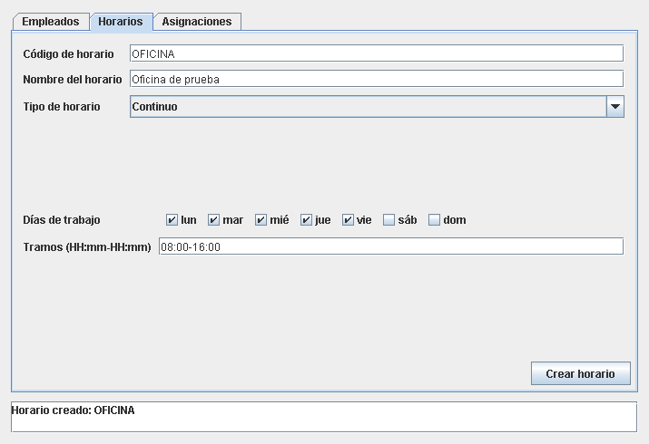
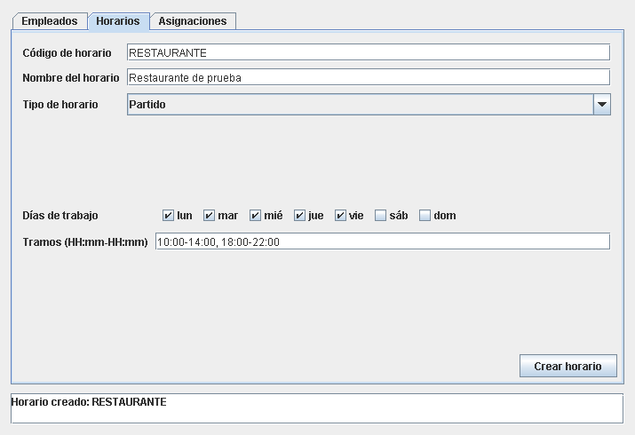
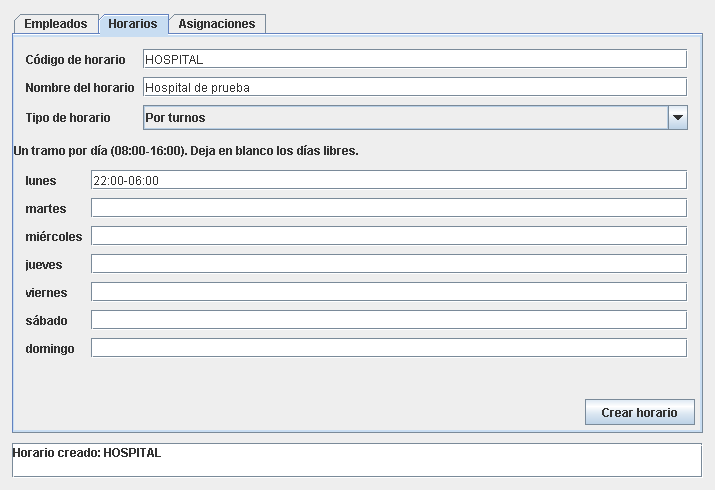

# Definición de horarios y recuperación de los datos

El 25 de noviembre de 2026 se crearon estos ejemplos con el formulario **Administración → Horarios**. Se pulsó **Crear horario**, se esperó la confirmación del servidor y se capturó el panel Swing. El ensayo usó las rutas HTTP de Javalin con el conector en memoria de Jetty y los repositorios de archivos del proyecto en un directorio temporal. El recorrido con el contenedor Docker está documentado en el [informe de la sesión 14](../sesion14/20261125-132344-bec03b/RESULTADO.md).

| Caso | Tipo en la API | Definición guardada |
|---|---|---|
| Oficina | `CONTINUOUS` | Lunes a viernes de 08:00 a 16:00 |
| Restaurante | `SPLIT` | Lunes a viernes de 10:00 a 14:00 y de 18:00 a 22:00 |
| Hospital | `SHIFT` | Turno del lunes a las 22:00 hasta el martes a las 06:00 |

### Oficina · Jornada continua

### Restaurante · Jornada partida

### Hospital · Turno nocturno

## Verificación de persistencia

1. Se leyeron las tres definiciones mediante `GET /api/v1/schedules/{id}`. El backend devolvió los tipos y los tramos de la tabla.
2. Se creó el empleado ficticio `EMP-PRUEBA` y se le asignó el horario de oficina del 24 al 26 de noviembre. Se registraron una entrada y una salida en el centro `AULA`. Una segunda entrada consecutiva obtuvo HTTP 409.
3. Se detuvo el servidor y se inició una nueva instancia de Javalin con el mismo directorio de datos.
4. Se repitieron las consultas del empleado, los tres horarios, la asignación, los dos fichajes y el resumen del día. Las respuestas JSON coincidieron con las obtenidas antes del reinicio, incluidas las marcas temporales de los fichajes y la incidencia `LATE_ARRIVAL` del resumen. Las incidencias se reconstruyen al consultar la jornada.

En este ensayo los dos fichajes se hicieron en el mismo minuto. El resultado fue de cero minutos completos trabajados. En la ejecución con Docker transcurrieron 65 segundos y la consulta mostró un minuto trabajado.
