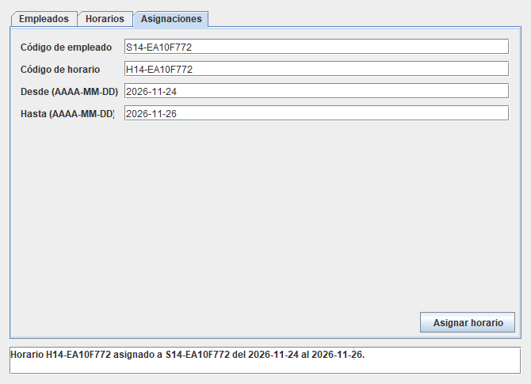
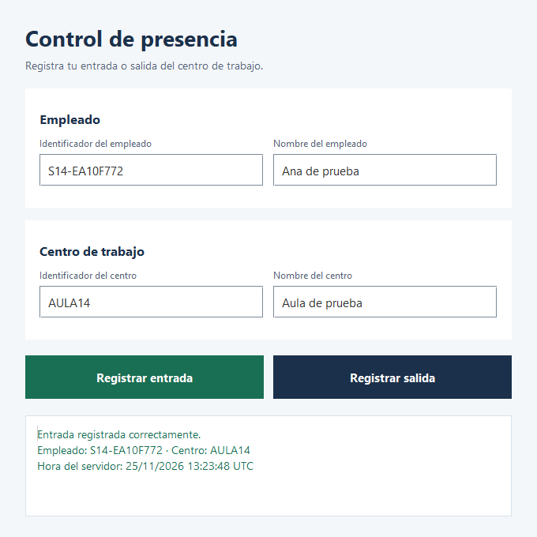
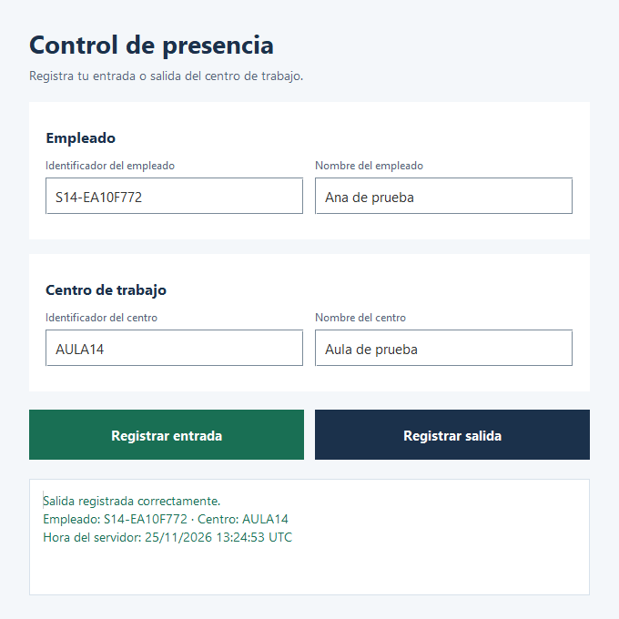
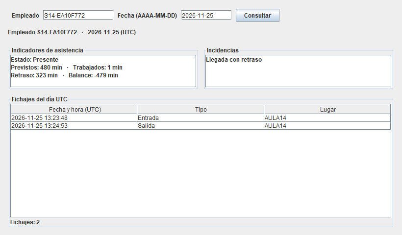
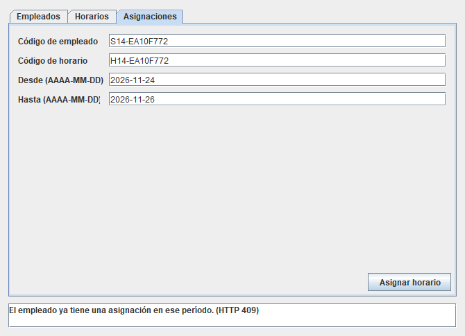

# Control de Presencia · Sesión 14

Recorrido automatizado sobre los formularios Swing de Administración, Registro y Consulta diaria.
Las horas de la entrada y de la salida proceden del servidor. La prueba usó datos ficticios.

| Comprobación | Resultado observado |
|---|---|
| Entorno | Docker Compose · TCP local |
| Empleado y horario | S14-EA10F772 · H14-EA10F772 |
| Centro | AULA14 |
| Entrada UTC | 2026-11-25T13:23:48.418745304Z |
| Salida UTC | 2026-11-25T13:24:53.676714180Z |
| Jornada prevista | 480 min |
| Tiempo trabajado | 1 min |
| Balance | -479 min |
| Estado de la jornada | Presente |
| Segunda asignación para el mismo período | Rechazada por solapamiento |

Las capturas contiguas al informe muestran los paneles tal como se renderizaron durante esta ejecución.

Commit local del proyecto: d782111

Servicio Compose: backend. Imagen en ejecución: sha256:9456d0c4528062eb7c864af9a7a57a9251db124a0493cee6ff6c9e67bab14fce

## Capturas

